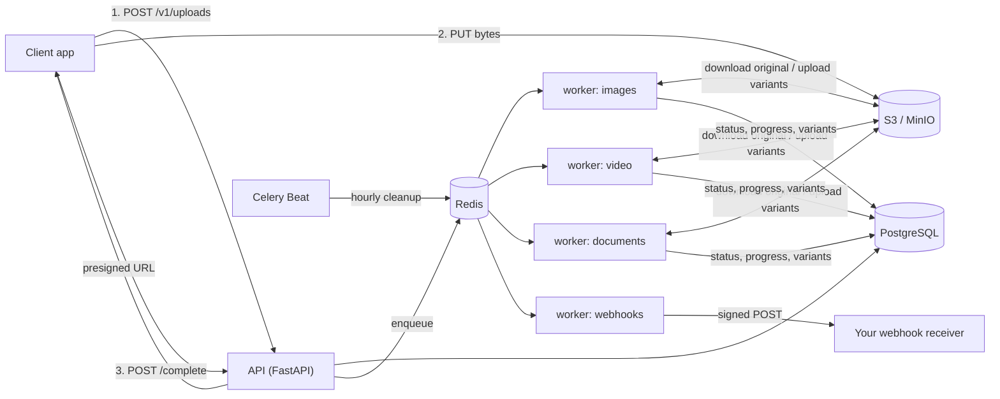

# MediaPipe

**MediaPipe takes care of the file handling in your app.** Your users upload photos, videos and
documents; MediaPipe stores them safely, creates every size and format you need (thumbnails,
web-ready images, compressed videos, searchable text), shows live progress, and tells your app the
moment each file is ready. You write none of the media code and you run none of the heavy servers
yourself.

It is a backend service with a REST API, built to be dropped behind any web or mobile app. It runs
on your own infrastructure, works with AWS S3 or any S3-compatible storage, and keeps every
customer's files completely separate.

---

## Features

- **Direct-to-storage uploads.** The API hands out presigned URLs, so large files never pass
  through (or overload) your servers. Files over 100 MB use multipart upload automatically.
- **Images:** EXIF rotation fixed, metadata stripped, `thumb` (200×200 crop), `medium` (800 px) and
  `large` (1600 px) variants in WebP *and* the original format. Never upscales.
- **Video:** transcoded to H.264/AAC MP4 (`ffmpeg`), poster frame at 1 s, 3 preview thumbnails,
  duration and resolution recorded, real progress from ffmpeg's own output.
- **Documents:** text extraction and page count for PDF and DOCX, plain-text passthrough, document
  metadata, first-page preview image for PDFs.
- **Presets:** built-in defaults, plus per-project presets (custom sizes, formats, quality…).
- **Live progress:** poll `GET /v1/jobs/{id}` or stream `GET /v1/files/{id}/events` (SSE).
- **Signed webhooks:** `file.processed` / `file.failed`, HMAC-SHA256 with replay protection,
  retries with backoff, a delivery log and one-click resend.
- **Safe by default:** content sniffing (the declared type is never trusted), per-type size limits,
  hashed API keys, strict per-project isolation, per-key rate limiting, SSRF-guarded webhooks.
- **Reliable:** retries only for transient failures, idempotent tasks, abandoned uploads cleaned up
  automatically.

## Architecture



| Component | Role |
|---|---|
| `app/api` | FastAPI routers: uploads, files, jobs, presets, webhooks, API keys, health |
| `app/services` | Business logic: storage, upload verification, job runner, webhooks, cleanup |
| `app/processors` | **Pure** processing functions (`image.py`, `video.py`, `document.py`): local files in, local files out. No database, queue or storage code, so they are trivial to unit test |
| `app/workers` | Celery app and tasks; queues `images`, `video`, `documents`, `webhooks` |
| `app/db` | SQLAlchemy 2.0 models and Alembic migrations |

## Quick start

Requires Docker.

```bash
docker compose up --build
```

This starts the API, a worker (all queues), Celery Beat, PostgreSQL, Redis and MinIO. Migrations and
bucket creation happen automatically.

- API + interactive docs: <http://localhost:8000/docs>
- MinIO console: <http://localhost:9001> (`minioadmin` / `minioadmin`)

### Try it with curl

```bash
API=http://localhost:8000

# 1. Create a project (admin token from docker-compose / ADMIN_TOKEN). The key is shown once.
KEY=$(curl -s -X POST $API/v1/admin/projects \
  -H "X-Admin-Token: dev-admin-token" -H "Content-Type: application/json" \
  -d '{"name":"My app"}' | jq -r .api_key)
AUTH="Authorization: Bearer $KEY"

# 2. Ask for an upload URL
SIZE=$(wc -c < photo.jpg | tr -d ' ')
UPLOAD=$(curl -s -X POST $API/v1/uploads -H "$AUTH" -H "Content-Type: application/json" \
  -d "{\"filename\":\"photo.jpg\",\"content_type\":\"image/jpeg\",\"size\":$SIZE}")
FILE_ID=$(jq -r .file_id <<<"$UPLOAD"); URL=$(jq -r .upload.url <<<"$UPLOAD")

# 3. Upload directly to storage (send the same Content-Type)
curl -s -X PUT "$URL" -H "Content-Type: image/jpeg" --data-binary @photo.jpg

# 4. Confirm: MediaPipe verifies size and real file type, then queues processing
curl -s -X POST $API/v1/uploads/$FILE_ID/complete -H "$AUTH" | jq .

# 5a. Poll...
curl -s $API/v1/files/$FILE_ID -H "$AUTH" | jq '{status, metadata, variants: [.variants[] | {name, width, height, url}]}'
# 5b. ...or stream progress (Server-Sent Events)
curl -N $API/v1/files/$FILE_ID/events -H "$AUTH"
```

`examples/demo.sh <file> <content-type>` runs the whole flow in one go. Videos and PDFs work the
same way (`video/mp4`, `application/pdf`, …); only the variants differ.

**Receive a webhook**

```bash
curl -s -X POST $API/v1/webhooks -H "$AUTH" -H "Content-Type: application/json" \
  -d '{"url":"https://your-app.example.com/hooks/mediapipe","events":["file.processed","file.failed"]}'
# -> {"id": "...", "secret": "whsec_...", ...}   (the secret is shown once)

curl -s "$API/v1/webhooks/deliveries?success=false" -H "$AUTH"           # delivery log
curl -s -X POST $API/v1/webhooks/deliveries/<id>/resend -H "$AUTH"       # resend one
```

Each delivery carries `X-MediaPipe-Signature: t=<unix time>,v1=<hex>` where `v1` is
`HMAC_SHA256(secret, "<t>.<raw request body>")`. Verify it over the **raw** bytes and reject old
timestamps:

```python
import hashlib, hmac, time


def verify(secret: str, header: str, raw_body: bytes, tolerance: int = 300) -> bool:
    parts = dict(p.split("=", 1) for p in header.split(","))
    expected = hmac.new(
        secret.encode(), parts["t"].encode() + b"." + raw_body, hashlib.sha256
    ).hexdigest()
    return abs(time.time() - int(parts["t"])) <= tolerance and hmac.compare_digest(
        expected, parts["v1"]
    )
```

```js
const crypto = require("crypto");
function verify(secret, header, rawBody, tolerance = 300) {
  const p = Object.fromEntries(header.split(",").map((kv) => kv.split("=")));
  const expected = crypto.createHmac("sha256", secret).update(`${p.t}.${rawBody}`).digest("hex");
  const fresh = Math.abs(Date.now() / 1000 - Number(p.t)) <= tolerance;
  return fresh && expected.length === p.v1.length &&
    crypto.timingSafeEqual(Buffer.from(expected), Buffer.from(p.v1));
}
```

**Custom presets**

```bash
curl -s -X POST $API/v1/presets -H "$AUTH" -H "Content-Type: application/json" -d '{
  "name": "avatar", "media_type": "image",
  "config": {"variants": [{"name": "avatar", "width": 256, "height": 256, "fit": "cover"}],
             "formats": ["webp"]}}'
# then: POST /v1/uploads with "preset": "avatar"
```

### Local development without Docker

```bash
uv venv --python 3.12 .venv && source .venv/bin/activate
uv pip install -e ".[dev]"
make test      # no Docker needed: SQLite, moto (S3), fakeredis, Celery eager mode
make lint      # ruff + mypy
cp .env.example .env && make migrate   # then run uvicorn / celery against your own services
```

`ffmpeg` and `ffprobe` must be on `PATH` for video; without them the video tests are skipped with a
clear message rather than failing.

## API overview

All endpoints except `/health`, `/ready` and `/v1/admin/*` use `Authorization: Bearer <api_key>`.
Errors always look like `{"error": {"code": "...", "message": "...", "details": {}}}`.
Full request/response schemas: `/docs` (Swagger) and `/redoc`.

| Method | Path | Purpose |
|---|---|---|
| POST | `/v1/uploads` | Create upload, get presigned URL(s) |
| POST | `/v1/uploads/{file_id}/complete` | Confirm upload, start processing |
| GET | `/v1/files` | List files (paginated; filter by `status`, `type`) |
| GET | `/v1/files/{file_id}` | Details, jobs, variants with download URLs |
| DELETE | `/v1/files/{file_id}` | Delete file, variants and storage objects |
| GET | `/v1/files/{file_id}/events` | SSE progress stream |
| GET | `/v1/jobs/{job_id}` | Job status and progress |
| POST | `/v1/jobs/{job_id}/retry` | Retry a failed job |
| GET / POST / DELETE | `/v1/presets` | Manage processing presets |
| GET / POST / DELETE | `/v1/webhooks` | Manage webhook endpoints |
| GET | `/v1/webhooks/deliveries` | Delivery log (every attempt) |
| POST | `/v1/webhooks/deliveries/{id}/resend` | Resend a delivery |
| GET / POST / DELETE | `/v1/api-keys` | Manage the project's API keys |
| POST | `/v1/admin/projects` | Create a project + first key (`X-Admin-Token`) |
| GET | `/health`, `/ready` | Liveness / readiness (DB, Redis, storage) |

File statuses: `pending_upload → uploaded → processing → processed | failed` (or `rejected` when
verification fails). Job statuses: `queued → processing → succeeded | failed`.

Supported uploads: JPEG, PNG, WebP, GIF, MP4, MOV, WebM, PDF, DOCX, TXT. Default limits: images
25 MB, documents 50 MB, video 2 GB (all configurable).

## Design decisions

**Presigned URLs; the API never touches file bytes.** Uploads and downloads go straight between the
client and object storage. The API stays small and cheap to scale, a 2 GB video cannot exhaust API
memory or bandwidth, and storage does what it is best at. The API only *verifies* afterwards:
`HEAD` for existence and size, then a range-read of the first bytes to sniff the real type. DOCX
files (ZIP containers) are opened to confirm they really contain a Word document. A mismatch
rejects the file and deletes the object.

**Separate queues.** `images`, `video`, `documents` and `webhooks` are different Celery queues, so a
backlog of 30-minute transcodes never delays thumbnails or webhook delivery. Scale them
independently: run more `-Q video` workers on bigger machines. Tasks are acknowledged *after*
completion (`acks_late`), so a worker that dies mid-job has its job redelivered.

**State lives in PostgreSQL, not in Celery.** The `jobs` table is the source of truth for status,
progress, attempts and errors. Celery results are disabled. That makes polling, SSE and the manual
retry endpoint simple and survives Redis restarts. SSE streams poll the database (about once a
second per open stream), which works across any number of API replicas without a pub/sub layer.

**Retries: only for things that can get better.** Transient failures (storage timeouts, 5xx,
throttling, connection resets) are retried with exponential backoff plus jitter, up to 3 attempts.
Permanent failures (corrupt file, unsupported codec, password-protected PDF) fail immediately with
a human-readable `error`, because retrying cannot help. Failed jobs can be re-queued with a fresh
attempt budget via `POST /v1/jobs/{id}/retry`.

**Idempotent tasks.** Variants have a unique `(file_id, name)` and deterministic storage keys
(`projects/<project>/files/<file>/variants/<name>`). Re-running a job (duplicate delivery, a
crashed worker, a manual retry) overwrites the same rows and objects instead of duplicating them,
removes variants the new run no longer produces, and a job already `succeeded` is skipped. The
`complete` endpoint claims the state transition with a conditional `UPDATE`, so concurrent calls
create exactly one job. Jobs snapshot their preset configuration, so editing or deleting a preset
never changes work already queued.

**Webhook security.** Payloads are signed with a per-endpoint secret using HMAC-SHA256 over
`timestamp.body`; the timestamp is part of the signed message so a captured request cannot be
replayed later. Every attempt (success or not) is logged with its HTTP status. Registration rejects
private/loopback targets and credentials in URLs, and the host is re-resolved at delivery time to
catch DNS tricks (`WEBHOOK_ALLOW_PRIVATE_URLS=true` lifts this for local development).
Payloads contain metadata and variant names but no URLs, because presigned URLs expire; fetch
`GET /v1/files/{id}` for fresh ones.

**Multi-tenancy.** Every query is scoped by `project_id` taken from the authenticated key, never
from the request. Another project's resources return `404`, indistinguishable from nonexistent
ones. Isolation is covered by tests for files, jobs, uploads, presets, webhooks, deliveries, SSE and
API keys. API keys are random 256-bit values stored only as SHA-256 hashes; a short prefix is used
for lookup.

**Rate limiting** is a Redis fixed window per API key (`RATE_LIMIT_PER_MINUTE`, default 60), with
`X-RateLimit-*` headers and `Retry-After`. If Redis is unreachable the limiter fails open rather
than taking the API down.

## Configuration

Everything comes from environment variables; see [`.env.example`](.env.example) for the full,
documented list. To use AWS S3 instead of MinIO, leave `S3_ENDPOINT_URL` empty and set the region,
credentials (or an instance role), and `S3_BUCKET`; no code changes.

For browser uploads, configure CORS on the bucket to allow `PUT` from your app's origin and expose
the `ETag` header (needed for multipart uploads). Consider an S3 lifecycle rule that aborts
incomplete multipart uploads as a second line of defense behind the built-in cleanup task.

## Testing and CI

```bash
make test     # pytest with coverage on services/ and processors/ (currently ~91%)
make lint     # ruff check, ruff format --check, mypy --strict
```

Tests need no external services. They cover the full flow (upload → complete → job → variants →
signed webhook), tenant isolation, type-sniffing rejection, size limits, retry vs. permanent
failure, idempotency, signature verification, migrations matching the models, and OpenAPI
completeness. GitHub Actions runs ruff, mypy and pytest on every push, and applies the migrations
to a real PostgreSQL service.

## Known limitations

- Multipart part URLs expire with the upload URL (15 minutes by default). A client that cannot
  upload all parts in that window must restart the upload; there is no "refresh part URLs" call yet.
- Files are validated by type and structure, not scanned for malware. Add a scanning step if you
  accept uploads from untrusted users.
- Animated GIFs are processed as a single frame; no animated output.
- Video transcoding runs one ffmpeg process per job with a timeout (`VIDEO_TIMEOUT_SECONDS`) but no
  CPU/memory sandboxing; run video workers on dedicated hosts or containers with resource limits.
- Redis' visibility timeout is set to 8 hours; jobs that can legitimately run longer would be
  redelivered (safe because tasks are idempotent, but wasteful).
